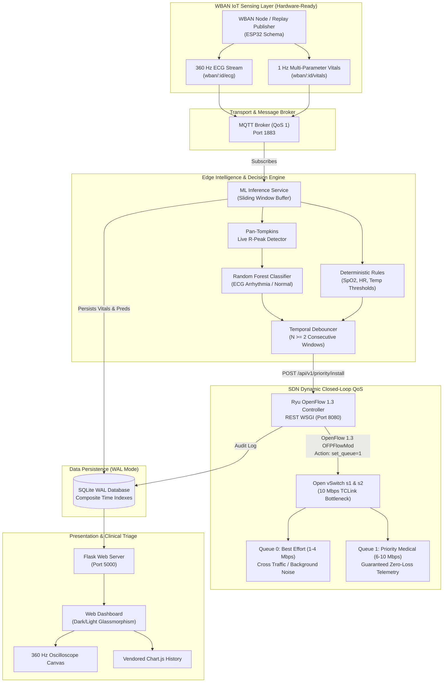
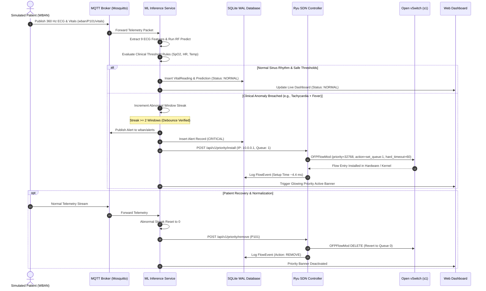

# CardioSDN: End-to-End System Architecture

This document details the architectural design of **Intelligent Healthcare Monitoring using Software-Defined Networking, IoT, and Machine Learning**.

---

## 1. System Architecture Diagram

---

## 2. Closed-Loop Sequence Diagram

The closed-loop timing cycle illustrates the rapid response from anomaly injection to network traffic prioritization:

---

## 3. Data Flow Walkthrough
1. **IoT Sensing:** Replay node generates continuous 360 Hz ECG and 1 Hz multi-parameter physiological telemetry matching ESP32 firmware output.
2. **QoS 1 Ingestion:** Telemetry is published over MQTT to `wban/<patient_id>/vitals` and `wban/<patient_id>/ecg`.
3. **Hybrid Classification:**
   - Morphological Pan-Tompkins analysis and Random Forest classification detect ectopic ventricular beats.
   - Deterministic rules independently flag hypoxemia, tachycardia, bradycardia, or fever.
4. **Temporal Filter:** Debouncing filter enforces 2 consecutive abnormal windows to avoid network oscillation on spurious noise.
5. **SDN Allocation:** An alert initiates an asynchronous REST call to the Ryu controller, which modifies switch flow tables in ~4.4 ms, routing the patient's IP traffic to guaranteed HTB Queue 1.
6. **Clinical Monitoring:** The Flask dashboard consumes real-time SSE telemetry, updates the 360 Hz oscilloscope canvas, and illuminates the SDN priority indicator.
