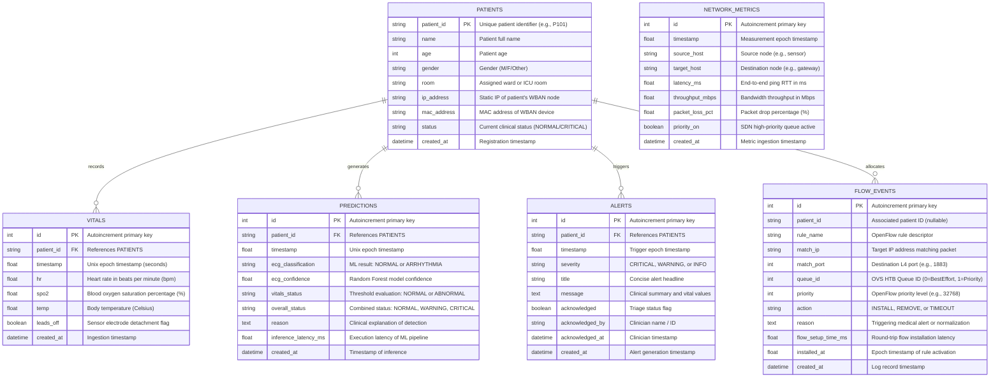

# Healthcare SDN-IoT Database Architecture & Entity-Relationship Diagram

This document describes the relational database schema implemented in SQLite (WAL mode) via SQLAlchemy ORM. The schema is fully compliant with PostgreSQL and TimescaleDB for high-throughput time-series production scaling.

## Mermaid ER Diagram

## Indexing Strategy for High Concurrency
1. **Time-Range Lookups:** Composite indexes `(patient_id, timestamp)` on `vitals`, `predictions`, and `alerts` ensure $O(\log N)$ historical queries.
2. **Alert Management:** Index `(acknowledged, severity)` powers real-time triage queries without full table scans.
3. **SDN Performance Benchmarks:** Index `(timestamp, priority_on)` provides immediate slicing between baseline and prioritized states.
